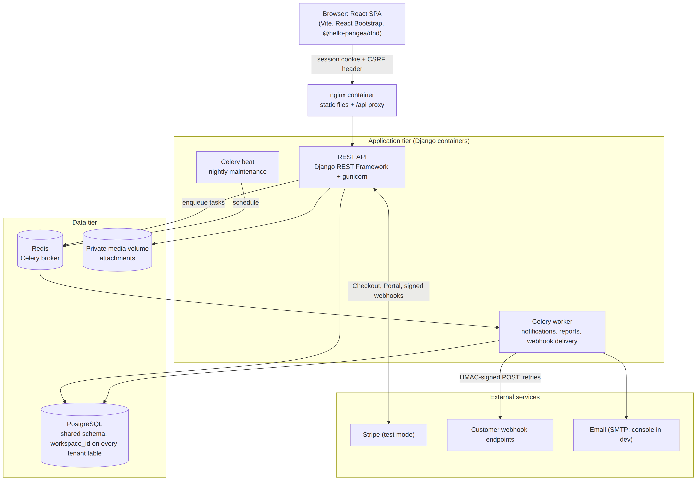
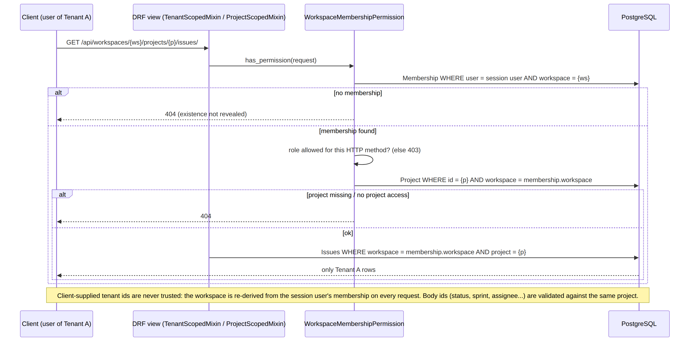
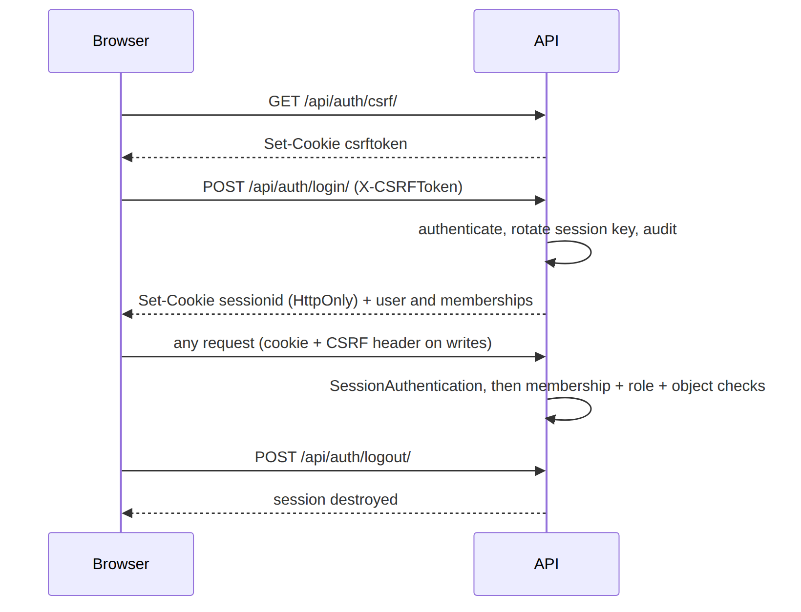
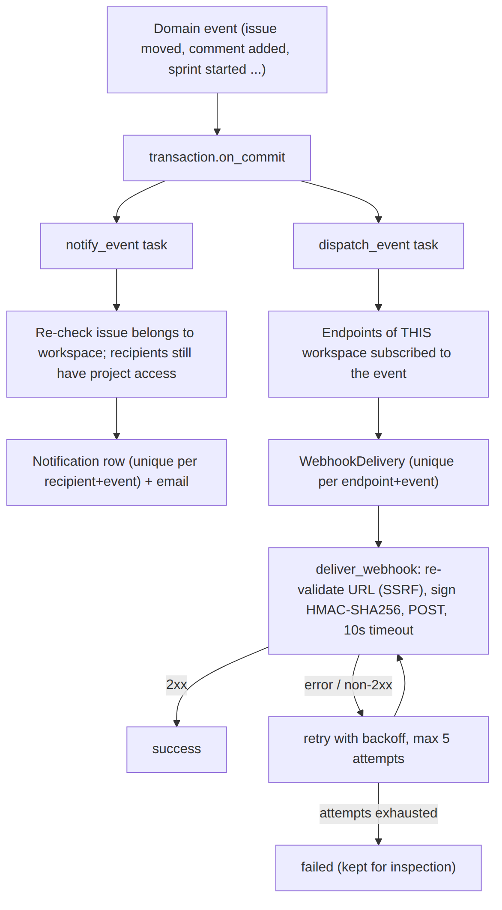
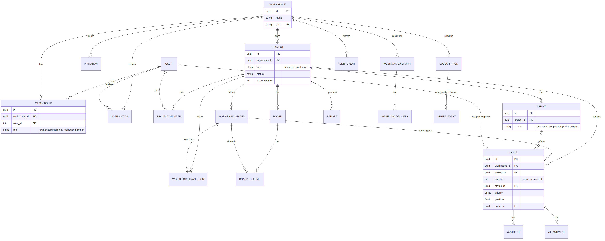

# Architecture

Diagrams (Mermaid source and rendered PNG in `docs/diagrams/`):

**Tiers.** React SPA served by nginx, which also proxies `/api` to Django (gunicorn). PostgreSQL holds all data (shared schema,
`workspace_id` on every tenant table). Redis is the Celery broker; a worker runs notifications, reports and webhook delivery;
beat runs nightly maintenance. Attachments sit on a private volume and are served only through an authorized view.
Stripe (test mode) and customer webhook endpoints are the external services.

## Tenant isolation

## Authentication and authorization flow

## Background jobs and webhooks

## Data model

Key constraints: unique project key per workspace; unique issue number per project; unique membership per
(workspace, user); at most one **active** sprint per project (partial unique index); at most one active Platform Administrator
(partial unique index); unique notification per (recipient, event) and webhook delivery per (endpoint, event);
`Issue.status` is `PROTECT` so a status in use cannot be deleted. Indexes lead with `workspace` or `project` on the hot paths
(Kanban, issue lists). Version-sensitive: no DB `CheckConstraint`s are used on purpose (see `docs/versions.md`).

## Scaling notes (not measured claims)
The API is stateless, so it scales horizontally behind a load balancer; Postgres and Redis are the shared state. Expensive work
(reports, webhooks, email) is already off the request path. Likely first bottlenecks: the Kanban endpoint at very large
boards (capped at 500 issues), and webhook delivery volume. Capacity has **not** been measured; use `scripts/perf_check.py`.
